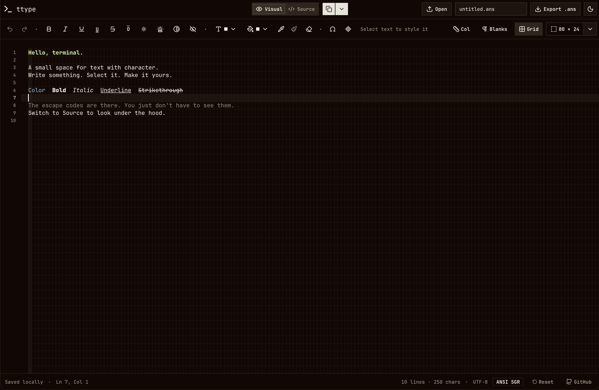

# ttype: editing ANSI terminal documents in the browser
#web

[ttype](https://ttype.sh) is a browser-based editor for ANSI art and styled terminal text. It combines a visual editor with an editable source view, making it possible to compose colored text, boxes, and simple terminal layouts without manually writing every escape sequence.

The project is built with Next.js, React, TypeScript, and CodeMirror 6. Document editing and storage happen in the browser, with no account or document backend.



## From visual editing to terminal output

ANSI text uses escape sequences to change how a terminal displays the characters that follow. SGR, short for Select Graphic Rendition, controls attributes such as bold, underline, foreground color, and background color.

In ttype's Source view, a bold label can be written as:

```text
\x1b[1mStatus\x1b[0m
```

Here, `\x1b` is a readable representation of the ESC character. The first sequence enables bold; the second resets formatting. Export replaces that notation with actual ESC bytes, producing a file a terminal can render.

A typical workflow is:

1. Start with the welcome document or open a UTF-8 `.ans`, `.ansi`, or `.txt` file.
2. Select text and apply styles or colors in Visual mode. With no selection, formatting applies to subsequent typing.
3. Insert box-drawing characters, blocks, arrows, and symbols from the character picker.
4. Switch to Source mode to inspect or edit the ANSI sequences.
5. Export the document and preview it in a terminal:

```sh
cat untitled.ans
```

The editor also provides a command that clears the terminal and prints the document. Its generator quotes the document as data and encodes control characters for `printf`, so shell syntax inside the text prints literally. A final reset prevents the document's formatting from carrying into the next prompt.

## A character grid for composing layouts

Terminal layouts depend on character positions. ttype keeps lines unwrapped, uses four-column tabs, and offers a grid, column ruler, and visible whitespace markers. These guides affect the display without adding characters to the exported document.

Optional terminal bounds show an **80 × 24**, **80 × 25**, or **132 × 24** area. They help check whether a composition fits a target screen while allowing text outside the guide.

Alt-drag creates a rectangular selection for editing columns. The **Place cursor anywhere** tool lets a click beyond the existing text add the spaces and newlines needed to reach that cell. This makes positioning a label or starting a box closer to drawing on a character canvas.

Font metrics matter as much as the guides. The app bundles the full JetBrains Mono font, including box-drawing and block glyphs, so those characters share the text's metrics. The grid follows CodeMirror's measured character dimensions, and the row height follows the font's cell geometry to keep adjacent blocks and box strokes aligned.

## Keeping text and formatting together

Visual mode stores plain text alongside a style array indexed by UTF-16 offset, matching CodeMirror's document positions. Each entry describes the attributes and colors at that position. Adjacent entries can share the same style object, and runs with matching styles become CodeMirror decorations.

This separates three responsibilities:

- The ANSI parser turns supported escape sequences into text and styles.
- CodeMirror manages editing, selections, and history, with custom state effects tracking formatting.
- The serializer turns the styled document back into ANSI output.

Formatting participates in undo and redo alongside text changes. History stores affected style ranges rather than copying the entire style array for every keystroke.

The source view escapes control characters and doubles literal backslashes. That distinction allows a real ESC character and the literal text `\x1b` to survive source conversion without becoming confused.

## Preserving formatting through the clipboard

Copying in Visual mode provides plain text, styled HTML, and a ttype-specific payload containing ANSI fragments. The HTML also carries that payload as a fallback for browsers that discard custom clipboard formats.

Pasting between ttype editors restores the attributes and colors, including across browser tabs and rectangular selections. Other applications receive plain text or styled HTML where supported. Text from other applications follows the normal plain-text paste behavior.

Separate **Copy style** and **Paste style** controls transfer formatting without changing the system clipboard. They can apply a selected character's style to another selection or set the style for future typing.

## Scope and storage

Visual mode supports SGR attributes, selective resets, 16-color and 256-color input, and RGB colors. Serialization normalizes colors to 24-bit RGB, so visual editing preserves the supported formatting rather than the original choice of escape sequences.

Cursor movement, screen clearing, OSC hyperlinks, and unsupported attributes remain editable and exportable in Source mode. They prevent conversion to Visual mode because the document model describes styled text rather than an emulated terminal screen.

Rendering still depends on the destination terminal's font and supported attributes. Wide Unicode characters and emoji can also differ from the browser preview. Previewing the exported file in the intended terminal remains useful.

The current document and filename are saved in browser local storage. Opening another file replaces that draft, so exported files provide the durable copies.

Like [[markov-one-frontend-monte-carlo-visualizer|Markov One]], ttype puts the main interaction in the browser. Its central engineering challenge is keeping the visual document, editable source, clipboard, and exported file consistent as the user moves between them.

Try [ttype](https://ttype.sh) or explore the [source code on GitHub](https://github.com/tomx-sh/ttype).
